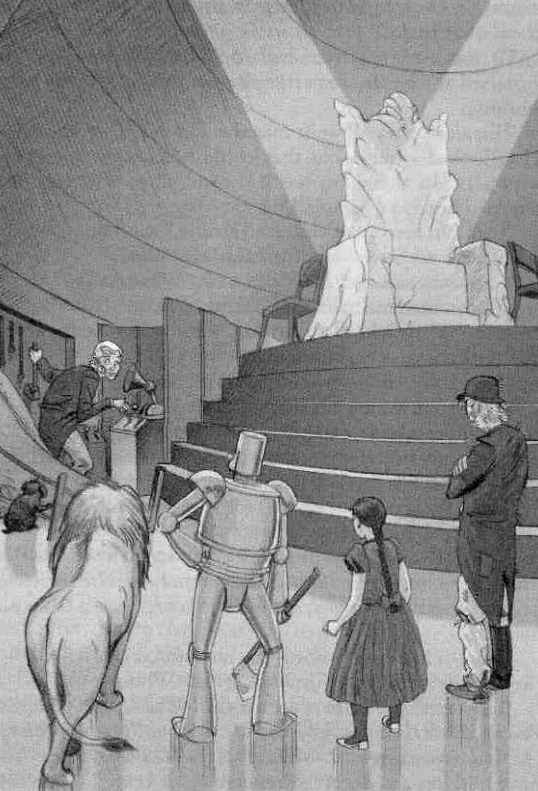

> "I am Oz, the Great and the Terrible," the Voice said.
"Where are you, Great Oz?" Dorothy asked.
"I am everywhere," the Voice said. "What do you want?"
"You wanted me to kill the Wicked Witch," Dorothy said bravely. "Well, I have killed her. Now you must send me back to Kansas, as you promised."
"You promised me brains," said the Scarecrow.
"You promised me a heart," said the Tin Man.
"I was promised courage," said the Cowardly Lion.
"Did I make all those promises?" the Voice said. "Well, the Wicked Witch is dead! I must have time to think."
"But I want my courage NOW!" the Cowardly Lion said, "And I WILL have it!"
He was so angry that he gave a great roar. The roar was so frightening that Toto jumped away from him. The little dog knocked over the screen. Behind the screen was a little old man.
The Tin Man ran towards the man and raised his axe.
"Who are you?" the Tin Man cried. "Where is Oz?"
"I am Oz," the little old man said. "Please don't hit me.
People think that I am a Great Wizard, but I'm only a man."
"Then you are a HUMBUG" the Tin Man said. 
"You have told lies and deceived everyone for years."
Behind the screen was a little old man.
"Yes, that's right. I am a humbug," the little old man said.
"But you are the only people who know that. I know lots of
tricks I tricked you, didn't I?"

The Wizard of Oz, L. Frank Baum

In any organized institution there's a desire to create an illusion of control, and that everything has been thought through. The fearless leader has it all figured out, and if he or she goes in a certain direction, it's because it's been pored over, analyzed and masterfully planned out. This happens at all organizational levels, from families to multinational organizations. There's a need to create the idea that there is a great and powerful wizard of Oz behind everything. "It's all under control", they'll make you think.

- But I've seen pastors preach a sermon on the fly, changing the program in the act.

- I've seen multinational companies talk up a "new initiative" that was made up on a whim.

- Entire countries have pivoted because of a single idea, a moment, or a petty argument.

[https://www.youtube.com/watch?v=E9eAshaPvYw](https://www.youtube.com/watch?v=E9eAshaPvYw)

If you have a chance, watch "The Death of Stalin" - a dark comedy based on the bumblings of the closest circle of Stalin's men. Although it feels bizarre, a lot of what was depicted is based in history.

### What does this mean?

With no Wizard of Oz wisely dictating what can and can't be done, go ahead and pitch the idea you've got. After all, who's to say the little man behind the curtain won't appreciate the input? At the end of the day, we're all making things up as we go, regardless of how structured things look. So try new things, look at the "bigger" players in your field in the eye, and know that if you're insecure and unsure, they probably feel the same way.
