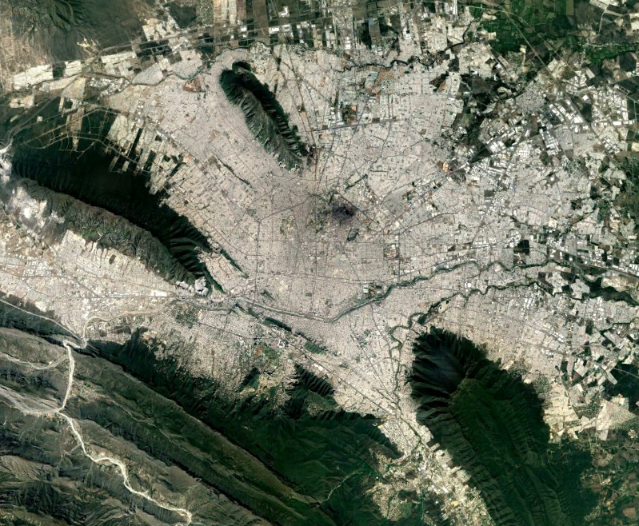

- Starlink is going to begin their [public beta](https://arstechnica.com/information-technology/2020/10/spacex-has-launched-enough-satellites-for-starlinks-upcoming-public-beta/) soon.

- Drone taxis are [in development](https://www.reuters.com/article/uk-aviation-volocopter/air-taxi-firm-volocopter-teams-up-with-schenker-to-deploy-heavy-lift-drones-idUKKCN26C0ST).

- High speed [electrical planes](https://www.rolls-royce.com/innovation/key-demonstrators/accel.aspx) are becoming available.

What does this all mean? 

Things are going to change, very quickly.

In 2015, [more people in India had access to smartphones than toilets](https://blogs.worldbank.org/opendata/are-cell-phones-becoming-more-popular-toilets). While this news bit was usually presented in the context of needing more sanitation, it can also be seen in another light: Innovation leapfrogging.

When innovation happens, it usually happens on the back of previous innovation.

Take indoor plumbing, for example. To have a workable, flushable toilet in a city, you have to have:

- Plumbing inside the house, connected to...

- a city sewage system, which leads to...

- a water treatment plant in the city, managed by...

- a working city government.

That's a lot of stacks. Take, for example, a smartphone:

- Electricity

- A cell network (Optional)

When you can remove the requirements for new technology, you can have rapid growth in a place that might lack things that we consider to be part of "civilized society".

Starlink is going to allow for high speed internet in the most remote places. This creates opportunities for knowledge workers to be as productive as anyone in the middle of a big tech hub. 

This now allows for certain things to be optional, like:

- City infrastructure

- Physical office space

- Proximity to your workplace

Drones are being developed at a breakneck speed. We're already experimenting with drone delivery, and aren't too far away from having people moved around in drones. This does something incredible: It makes roads optional, and eliminates geographical challenges in urban areas.

Monterrey, Mexico is a city built in between mountains and hills. What would be 10 minutes as-the-crow-flies is now a multi-hour car ride.

Imagine if those hills didn't matter anymore.

Imagine if living on those hills were now possible.

Imagine if you didn't need to save space for roads anymore.

Technology is changing, and urban planning is going to get leapfrogged. In the next 20 years certain things that were incredibly important (like interstates) may become irrelevant. What used to take decades to build up, can now be implemented in months. Little out-of-the-way towns can become tech hubs without warning. Knowledge workers can move away from high-price urban centers to rural parts of the world that offer low crime, cheap housing, and quality of life.

## My prediction?

- The importance of nations are going to give way to coalitions of cities (Think ancient greek city-states).

- New, important cities can pop up anywhere, since geography won't be as big a problem as they were before.

- Flight will become extremely cheap, and the hub-and-spoke model of air travel will give way to one-off Uber-style trips.

- Personal flight will finally become viable, because everything can be automated away.

- Most travel will be optional (though still important), since high-speed internet will reduce the need for in-person communication for knowledge work.
