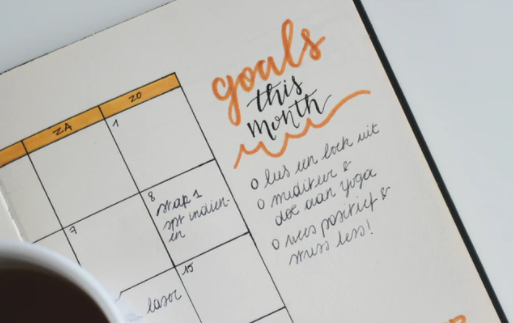
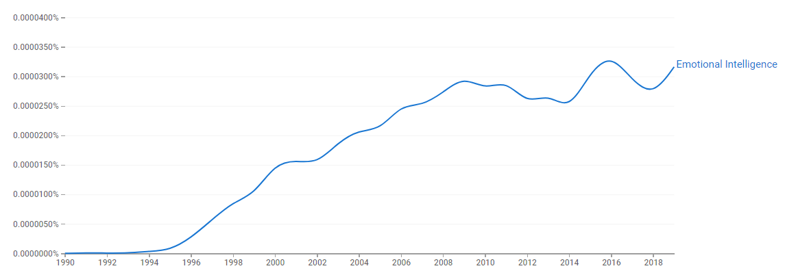

As we're winding down the year, most people take a look at what they've been able to accomplish, and what they'll aim for in their 2021 new year's resolutions.

*Plant a tree... Have a child... Write a book...*

However, there are some things that we should never get better at, because they avoid real growth. It's like being an expert at the [offline Chrome dinosaur game](https://codepen.io/MysticReborn/embed/rygqao?height=537&theme-id=light&default-tab=result) — it means you're not really getting much done. 

[http://gph.is/29JXvg2](http://gph.is/29JXvg2)

What are these things you should be bad at? Here's three:

# Lying

The truth should be your comfort zone. In business as in personal relationships, the truth eventually comes out. You can't dilute your product forever, you can't bait-and-switch every single time, you can't lie your way out of an uncomfortable conversation and think that your relationship will remain intact.

Abraham Lincoln is credited with saying:

> “You can fool all the people some of the time and some of the people all the time, but you cannot fool all the people all the time.”

Since the truth eventually comes out, lying is playing the short game.
It's a payday loan: immediate benefit at the expense of long-term growth. 
It's avoiding the necessary confrontations that will build you into a better version of yourself.
It's fooling yourself into thinking you're in a better place than you really are.

Even if you reject the moral reasoning for being truthful, there's a good argument to be made about the benefits of honesty from purely a business standpoint. Don't believe me? Here's Steven Covey, talking about the concepts in his book, "The Speed of Trust". 

[https://youtu.be/EId6BsvPwns](https://youtu.be/EId6BsvPwns)

So whether you care about being an upright person, or just want to be successful in life, make sure you stay a terrible liar.

# Mindreading

The term "Emotional Intelligence" is relatively new.

 According to [Wikipedia](https://en.wikipedia.org/wiki/Emotional_intelligence), it's defined as

> ...the capability of individuals to recognize their own emotions and those of others, discern between different feelings and label them appropriately, use emotional information to guide thinking and behavior, and manage and/or adjust emotions to adapt to environments or achieve one's goal(s).

*Although the term first appeared in 1964, it gained popularity in the 1995 book Emotional Intelligence, written by the science journalist Daniel Goleman.*

Emotional intelligence is great. Being able to understand verbal and non-verbal cues to identify emotions in others is a fantastic ability.

You know what's not great? Making the jump to conclusions about the motives of the other person.

You could be right, or you could be completely off-base.

[https://gph.is/1colwVY](https://gph.is/1colwVY)

Mindreading is another evasive skill. It's easier to make assumptions and act on those assumptions than admitting that you COULD have misinterpreted what you saw, and the best thing would be to just ask the other person.

With that said, it's not a guarantee that asking will yield the truth (See point 1 about lying), but there should always be a healthy suspicion in your own abilities to perceive emotion, motive and intention.

Instead of trying to become a better mind-reader, try getting better at listening, interacting, empathizing, and asking directed questions.

If the other person won't open up, choose to believe the person, and act as if it were true. "You're telling me you're fine, and even though it doesn't look like it to me, I'm going to choose to believe you." That way, the onus to be honest is on the other person, not on you to become a better mind-reader.

# The Art of Escape

[http://gph.is/Vx9dyv](http://gph.is/Vx9dyv)

You know what I'm talking about: ghosting, call-screening, convenient and timely sicknesses. It's similar to lying (which can be defined as a kind of verbal escape), but it involves actively avoiding a person, topic, or situation. 

Some people become better escape artists precisely because they're terrible liars. "So I don't have to lie", they think, "I'll just avoid the situation altogether". 

This actually shows a pretty poor ability to manage conflict. "Facing the music" means owning up to your own mistakes, inabilities, ignorance, and may even require putting limits on other people. But instead of answering the phone and saying "I don't want to talk to you right now", "I really can't help with that", or even the dreaded, "I'm sorry", some people decide that it's better to have 57 missed calls, skip out on the next meeting, or conveniently get COVID... for the fourth time.

Escape artists deprive themselves of the opportunity to become better at dealing with disappointment, rejection, or overbearing people. These things will be constants in our lives. As imperfect people, we're always failing to meet someone's standards, so it's better to learn how to deal with that situation, than get better at putting it off.

As we barrel toward 2021, I hope you continue to grow and improve in many, many areas of your life. Just don't get better at those three things.
